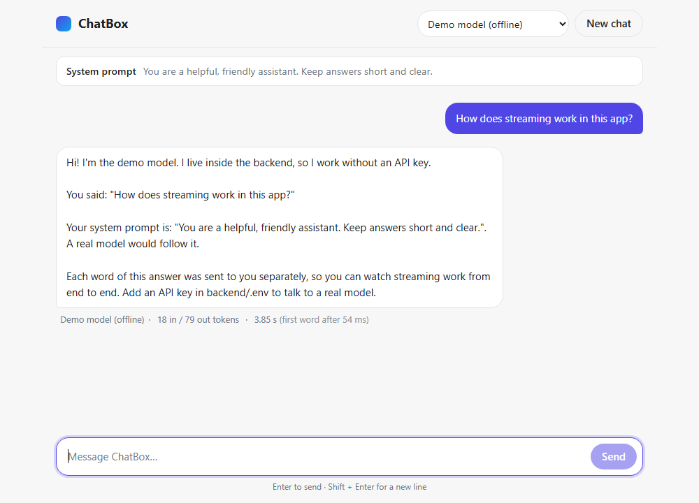
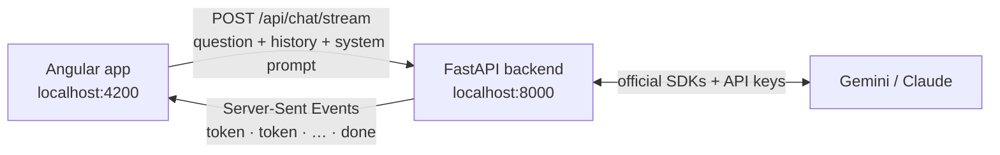

# ChatBox

A small ChatGPT-style chat app, built step by step to learn how AI chat apps work end to end.



## Features

- **Chat screen** in Angular — message bubbles, a text box (Enter to send), Stop button
- **Live streaming** — the reply appears word by word as the model writes it
- **Model dropdown** — switch between **Gemini** and **Claude** (even mid-conversation), plus an
  offline **Demo model** that needs no API key
- **System prompt box** — give the model standing instructions ("You are a pirate…")
- **Token count and time taken** under every answer, so you can compare models
- Light and dark mode; works on phone-sized screens

It runs locally only — nothing is deployed.

## How it works



1. You send a message. The Angular app posts the **whole conversation** (models have no memory)
   plus the system prompt to the backend.
2. The backend picks a **provider** for the chosen model and calls the model's streaming API.
3. Each piece of text is forwarded to the browser immediately as a **Server-Sent Event**, and the
   bubble grows as events arrive.
4. A final `done` event carries the **token counts** and **timings** shown under the answer.

The full walkthrough, with a step-by-step diagram and "where to look for…" table, is in
**[docs/how-it-works.md](docs/how-it-works.md)**.

## Tech stack

| Part | Technology |
| ---- | ---------- |
| Frontend | [Angular](https://angular.dev/) 22 — standalone components, signals, SCSS, Vitest |
| Backend | [FastAPI](https://fastapi.tiangolo.com/) (Python), `StreamingResponse` for SSE |
| Gemini | [`google-genai`](https://googleapis.github.io/python-genai/) SDK |
| Claude | [`anthropic`](https://github.com/anthropics/anthropic-sdk-python) SDK |
| Settings | `pydantic-settings` reading `backend/.env` |
| Tests | `pytest` (backend), Vitest (frontend) |

## Quick start

You need **Python 3.10+** and **Node.js 22+**. API keys are optional — the Demo model works
without one.

**1. Backend** (terminal 1)

```bash
cd backend
python -m venv .venv
.venv\Scripts\Activate.ps1          # Windows PowerShell  (macOS/Linux: source .venv/bin/activate)
pip install -r requirements-dev.txt
cp .env.example .env                # then paste your API keys into .env
uvicorn app.main:app --reload --reload-dir app
```

**2. Frontend** (terminal 2)

```bash
cd frontend
npm install
npm start
```

**3. Open http://localhost:4200** and say hi.

API keys go in `backend/.env`:

| Setting | Get one at |
| ------- | ---------- |
| `GEMINI_API_KEY` | https://aistudio.google.com/apikey |
| `ANTHROPIC_API_KEY` | https://platform.claude.com |

A model without a key is greyed out in the dropdown. Restart the backend after editing `.env`.

More detail: [backend/README.md](backend/README.md) · [frontend/README.md](frontend/README.md)

## Project structure

```
chatbox/
├── backend/                         Python · FastAPI
│   ├── app/
│   │   ├── main.py                  creates the app, CORS, plugs in routes
│   │   ├── core/config.py           settings + API keys from .env
│   │   ├── schemas/chat.py          request / response / stream-event shapes
│   │   ├── providers/               one class per AI service, same interface
│   │   │   ├── base.py              ChatProvider template + ChatChunk
│   │   │   ├── gemini_provider.py
│   │   │   ├── claude_provider.py
│   │   │   ├── demo_provider.py     offline, no key needed
│   │   │   └── registry.py          the model list + "give me the provider for X"
│   │   └── api/routes/
│   │       ├── health.py            GET  /api/health
│   │       ├── models.py            GET  /api/models
│   │       └── chat.py              POST /api/chat/stream  ← the streaming endpoint
│   └── tests/
├── frontend/                        TypeScript · Angular
│   └── src/app/
│       ├── components/              chat-header, system-prompt, message-list,
│       │                            message-bubble, chat-input
│       ├── services/
│       │   ├── chat-api.service.ts    talks to the backend, reads the stream
│       │   └── chat-store.service.ts  chat state (signals) + send / stop / clear
│       ├── models/chat.model.ts     TypeScript types
│       ├── pipes/duration.pipe.ts   2410 → "2.41 s"
│       └── utils/sse-parser.ts      raw stream text → events
└── docs/
    ├── how-it-works.md              the full walkthrough
    └── phases/                      one page per build phase
```

## Build phases

The project was built in seven small steps. Each phase is one commit with a git tag, so you
can see the code at any step:

```bash
git checkout phase-2   # the code right after phase 2
git checkout main      # back to the finished app
```

| Phase | What gets built | Read |
| ----- | --------------- | ---- |
| 1 | Backend foundation: FastAPI app, settings, CORS, health check | [phase-1](docs/phases/phase-1-backend-foundation.md) |
| 2 | Streaming endpoint (Server-Sent Events) with an offline demo model | [phase-2](docs/phases/phase-2-streaming-demo-model.md) |
| 3 | Real AI models: Gemini and Claude providers | [phase-3](docs/phases/phase-3-real-models.md) |
| 4 | Angular chat screen: bubbles, text box, live streaming, Stop | [phase-4](docs/phases/phase-4-angular-chat-screen.md) |
| 5 | Model dropdown and system prompt box | [phase-5](docs/phases/phase-5-model-dropdown-system-prompt.md) |
| 6 | Token count and time taken under each answer | [phase-6](docs/phases/phase-6-tokens-and-timing.md) |
| 7 | Documentation, troubleshooting, demo-video guide | [phase-7](docs/phases/phase-7-polish-and-docs.md) |

Each page explains the goal, the files added, the key ideas (in plain language), and how to
try that step yourself.

## API

| Method | URL | What it does |
| ------ | --- | ------------ |
| `GET` | `/api/health` | `{"status": "ok"}` if the server is up |
| `GET` | `/api/models` | The dropdown choices, each with `available: true/false` |
| `POST` | `/api/chat/stream` | `{model, system_prompt, messages}` → a stream of `token` events, then `done` (or `error`) |

Interactive docs: http://localhost:8000/docs (while the backend is running).

## Adding another model (e.g. OpenAI)

1. **Provider:** create `backend/app/providers/openai_provider.py` with a class that extends
   `ChatProvider` and implements `stream_reply(messages, system_prompt)` — yield
   `ChatChunk(text=...)` for each piece, then one `ChatChunk(input_tokens=..., output_tokens=...)`.
   Copy `gemini_provider.py` as a starting point.
2. **Settings:** add `openai_api_key` and `openai_model` to `backend/app/core/config.py` and
   `.env.example`.
3. **Registry:** add a `ModelInfo(...)` entry in `list_models()` and a branch in
   `_create_provider()` (`backend/app/providers/registry.py`).
4. **Types:** add `"openai"` to the `provider` field in `backend/app/schemas/chat.py` and
   `frontend/src/app/models/chat.model.ts`.
5. Add the SDK to `requirements.txt`. The frontend picks the new model up automatically.

## Recording a 30-second demo

On Windows 11, open the **Snipping Tool**, switch to **Record** (the video camera icon), and drag
a box around the browser window — or press **Win + Alt + R** to record with the Xbox Game Bar.
Save it in a `recordings/` folder (git ignores it). A 30-second script:

| Time | Show |
| ---- | ---- |
| 0–5 s | The empty chat screen; open the model dropdown |
| 5–15 s | Ask Gemini a question — watch it stream; point at the stats line |
| 15–25 s | Open the system prompt, type "You are a pirate", switch to Claude, ask a follow-up |
| 25–30 s | Compare the two stats lines (tokens and time) |

## Troubleshooting

| Problem | Fix |
| ------- | --- |
| "Can't reach the backend at http://localhost:8000/api" | Start the backend (`uvicorn …` in `backend/`) |
| A model is greyed out with "(no API key)" | Add its key to `backend/.env`, then restart the backend |
| "… rejected the API key" under a reply | The key in `backend/.env` is wrong or expired |
| Changes to `.env` don't take effect | `.env` is only read at start-up — stop the backend (`Ctrl+C`) and start it again |
| Code changes don't show up in the backend (Windows) | If the log says `Reloading...` but nothing follows, auto-reload got stuck: press `Ctrl+C` and start again |
| `python` not found on Windows | Use `py` instead, or install Python from python.org |

## Run the tests

```bash
cd backend && pytest        # 15 tests — no real API calls, no keys needed
cd frontend && npm test     # 14 tests — parser, store, pipe
```

## Ideas for next steps

- Render the model's Markdown (bold, lists, code blocks) instead of plain text
- Save conversations (e.g. SQLite) so they survive a page refresh
- Add a third provider (OpenAI) using the steps above
- Show the cost of each answer from the token counts
