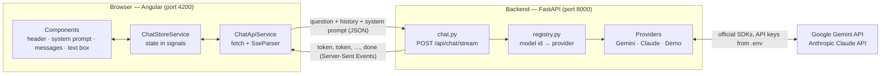
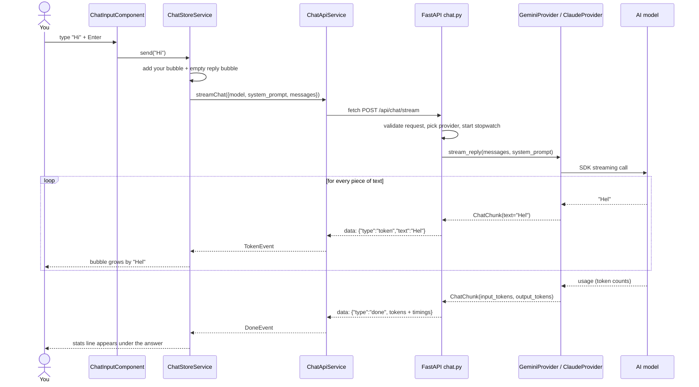

# How ChatBox works

This page follows one question from the moment you press Enter until the answer is complete,
and points to the file responsible for each step.

## The big picture



- The **browser** never talks to Google or Anthropic directly and never sees an API key.
- The **backend** hides the differences between models behind one method, `stream_reply()`.
- Text flows back **while it's being written**, as a stream of small events.

## One question, step by step



### 1. You press Enter — `chat-input.component.ts`

`onKeydown()` catches Enter (Shift+Enter makes a new line instead) and calls
`store.send(text)`.

### 2. The store prepares the request — `chat-store.service.ts`

`send()`:

1. Builds the request: the selected model, the system prompt, and the **whole conversation so
   far** (`toHistory()`) plus the new question. Models remember nothing between requests, so
   the history is re-sent every time.
2. Adds your message and an empty reply (status `streaming`) to the `messages` signal. The
   screen updates instantly: your bubble appears, plus a "typing" indicator.
3. Subscribes to `api.streamChat(request)`.

### 3. The request goes out — `chat-api.service.ts`

`streamChat()` uses the browser's `fetch()` (not Angular's `HttpClient`, which only hands over
complete responses) and reads the response body piece by piece. `SseParser`
(`utils/sse-parser.ts`) cuts the incoming text into events at each blank line.

### 4. The backend checks and routes it — `backend/app/api/routes/chat.py`

- FastAPI validates the JSON against `ChatRequest` (`schemas/chat.py`). Bad input → `422`.
- `get_provider()` (`providers/registry.py`) finds the provider for the model id. Unknown model
  → `404`; model without an API key → `400`.
- It returns a `StreamingResponse` wrapping `stream_reply_events()`, an async generator.

### 5. The provider talks to the model — `backend/app/providers/`

Each provider converts our messages to its SDK's format and streams the reply:

| Provider | SDK call | Notes |
| -------- | -------- | ----- |
| `GeminiProvider` | `client.aio.models.generate_content_stream()` | renames role `assistant` → `model` |
| `ClaudeProvider` | `client.beta.messages.stream()` | adds safety-filter fallbacks on newer models |
| `DemoProvider` | none — canned text | no API key needed; used by tests |

Each piece of text is yielded as `ChatChunk(text=...)`; the last chunk carries the token counts.

### 6. Text streams back — `stream_reply_events()` in `chat.py`

For every chunk it `yield`s one Server-Sent Event:

```
data: {"type": "token", "text": "Hel"}

```

It also records **when the first text arrived** and, at the end, sends:

```
data: {"type": "done", "input_tokens": 48, "output_tokens": 264, "total_ms": 2410, "first_token_ms": 620}

```

If anything fails mid-way, it sends `{"type": "error", "message": "…"}` instead — the HTTP
status was already sent with the first event, so errors have to travel inside the stream.

### 7. The screen updates — `chat-store.service.ts` → components

`handleEvent()` reacts to each event:

| Event | What the store does | What you see |
| ----- | ------------------- | ------------ |
| `token` | appends the text to the reply | the bubble grows, with a blinking cursor |
| `done` | sets status `done`, saves `stats` | cursor disappears; stats line appears |
| `error` | sets status `error`, saves the message | red error text under the reply |

Because `messages` is a **signal**, Angular re-draws only what changed. `MessageListComponent`
scrolls down to follow the new text (unless you've scrolled up to read).

### 8. Pressing Stop

`store.stop()` unsubscribes from the stream → the `AbortController` cancels the `fetch` →
FastAPI notices the browser left and stops the generator → the provider's `async with` block
closes the connection to the model. Nothing more is generated or billed.

## Where to look for…

| I want to change… | Look in |
| ----------------- | ------- |
| The look (colours, dark mode) | `frontend/src/styles.scss` (tokens), each component's `.scss` |
| The default system prompt | `systemPrompt` in `frontend/src/app/services/chat-store.service.ts` |
| Which Gemini / Claude model is used | `GEMINI_MODEL` / `CLAUDE_MODEL` in `backend/.env` |
| How Claude is called (effort, max length) | `build_request()` in `backend/app/providers/claude_provider.py` |
| The order of models in the dropdown | `list_models()` in `backend/app/providers/registry.py` |
| The streaming format | `schemas/chat.py` (backend) and `models/chat.model.ts` (frontend) |
| What's shown under each answer | `frontend/src/app/components/message-bubble/` |
